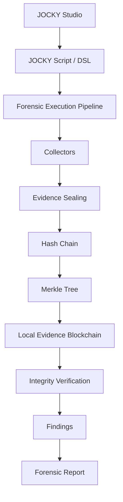

# JOCKY — Intelligent Digital Forensics & Evidence Integrity Platform

> **Defensive Digital Forensics, Cryptographic Evidence Sealing, and Provenance Verification**  
> *Developed for Smart India Hackathon (Problem Statement: SIH26148)*

[](https://www.python.org/)
[](https://fastapi.tiangolo.com/)
[](https://react.dev/)
[]()
[]()

---

## 1. Project Title

**JOCKY — Intelligent Digital Forensics & Evidence Integrity Platform**

---

## 2. SIH Problem Statement (SIH26148)

In modern cybersecurity operations, digital forensics and incident response (DFIR) teams must gather, preserve, and analyze forensic artifacts from compromised enterprise endpoints rapidly and decisively. However, traditional incident response workflows suffer from significant operational hurdles:

* Ad-hoc diagnostic and collection scripts trigger endpoint protection tools (Antivirus, EDR, SIEM), generating false-positive alarms or getting terminated mid-investigation.
* Evidence collection methods often lack cryptographic determinism and court-admissible chain of custody, rendering digital artifacts vulnerable to spoliation or legal challenge.
* High-level threat alerts are frequently disconnected from the underlying raw telemetry that triggered them, creating analysis bottlenecks.

**SIH26148** calls for a secure, defensive digital forensics platform that provides safe, structured forensic artifact acquisition, mathematical evidence integrity verification, and unified investigation correlation.

---

## 3. The Problem

Digital forensic evidence must withstand rigorous judicial cross-examination and adversarial scrutiny. In practice, investigative teams face four core dilemmas:

1. **Non-Deterministic Evidence Serialization**: Differing whitespace, key-ordering, and encoding across platforms cause identical JSON/dictionary payloads to produce conflicting cryptographic hashes.
2. **Missing Longitudinal Provenance**: Investigators cannot easily demonstrate the unbroken line of custody connecting an alert or finding back to the raw telemetry, the collector process, and the specific script executed.
3. **Undetected Post-Collection Tampering**: Once evidence is stored in relational databases or file stores, rogue actors or privileged insiders could manipulate records without leaving an explicit cryptographic trail.
4. **Execution Safety Risks**: Running unverified administrative commands on live forensic endpoints risks system instability or weaponization by malicious third parties.

---

## 4. The Solution

**JOCKY** resolves these challenges through a unified, defensive forensic architecture:

* **Domain-Specific Language (JOCKY DSL)**: A declarative, allowlisted scripting language that guarantees read-only, non-destructive endpoint inspection.
* **Cryptographic Evidence Sealing**: Adopts **RFC-8785 Canonical JSON** serialization paired with SHA-256 hashing to guarantee bit-for-bit identical hashes across any operating system.
* **Sequential Evidence Hash Chain**: Links each evidence envelope cryptographically to its predecessor, creating a tamper-evident audit trail.
* **Binary Merkle Tree & Local Evidence Blockchain**: Computes a root hash across all case evidence and anchors the state into an append-only cryptographic ledger.
* **End-to-End Vertical Provenance**: Connects every finding through an 8-stage traceability chain (`Finding -> Evidence -> Telemetry -> Collector -> Execution -> Script -> Merkle Root -> Blockchain Anchor`).
* **Explainable ML Threat Detection**: Deploys a 21-dimensional normalized feature extractor paired with a Random Forest classifier to identify anomalous persistence and execution patterns.
* **Interactive Investigation Workspace**: Provides an 8-tab operational center for deep evidence inspection, live anti-tamper demonstration, and multi-format report export.

---

## 5. Key Features

* **JOCKY Studio**: Visual script editor, syntax validator, and execution manager for authoring JOCKY forensic playbooks.
* **Forensic Collectors**: Specialized, read-only telemetry collectors for Windows Registry (`RunKey`, services), Running Processes, Network Sockets, and File System indicators.
* **Evidence Sealing**: Immutable evidence envelopes encapsulating raw telemetry, RFC-8785 canonical representation, and SHA-256 digests.
* **Evidence Provenance**: Complete genealogical traceability linking findings to specific collectors, execution runs, and script digests.
* **SHA-256 Hash Chain**: Cumulative cryptographic linkage ($H_i = \text{SHA256}(H_{\text{raw}} \,\|\, H_{\text{norm}} \,\|\, \text{collector} \,\|\, t_i \,\|\, H_{i-1})$) preventing undetectable insertion, deletion, or reordering of evidence.
* **Merkle Tree**: Deterministic binary Merkle tree generation with balanced odd-node duplication and cryptographic audit path verification.
* **Local Evidence Blockchain**: Append-only cryptographic ledger anchoring case evidence count, script digest, and Merkle root.
* **ML Threat Detection**: Supervised Random Forest classifier assessing threat levels across 21 forensic dimensions.
* **Explainable Findings**: Human-readable, factor-level explanations and MITRE ATT&CK technique mappings for every threat discovery.
* **Investigation Workspace**: An 8-tab analyst workspace providing case overviews, script provenance, task logs, evidence grids, finding matrices, and timeline views.
* **Forensic Timeline**: Chronological event correlation linking timestamped endpoint activity directly to sealed evidence envelopes.
* **Integrity Verification**: Real-time 4-point cryptographic audit scorecard verifying raw hashes, normalized hashes, Merkle root, and ledger block headers.
* **Anti-Tamper Demonstration**: Interactive simulation module that injects deliberate out-of-band tampering into evidence payloads, demonstrates immediate detection, and allows state restoration.
* **Forensic Reports**: One-click generation of court-admissible forensic reports exportable in JSON (machine-readable), HTML (court presentation), and CSV (spreadsheet audit).

---

## 6. Architecture

### Conceptual Forensic Lifecycle



### Vertical Provenance Flow

```text
Finding (FND-*)
     ↓
Supporting Evidence (EVD-*)
     ↓
Raw Endpoint Telemetry
     ↓
Forensic Collector
     ↓
Execution Lease
     ↓
JOCKY Script Digest (SHA-256)
     ↓
Binary Merkle Root
     ↓
Local Evidence Blockchain Anchor
```

---

## 7. Technology Stack

* **Backend Framework**: Python 3.11+, FastAPI (REST API), Uvicorn (ASGI server)
* **Data Persistence**: SQLAlchemy ORM with SQLite (deterministic zero-config deployment)
* **Language & Compiler**: Lark Parsing Toolkit (Lexer, Parser, AST, IR CodeGen)
* **Cryptographic Standards**: RFC-8785 Canonical JSON Serialization, SHA-256 Hashing, Binary Merkle Trees
* **Machine Learning**: scikit-learn (Random Forest Classifier), joblib, numpy
* **Authentication & Security**: PyJWT (HMAC-SHA256), passlib (bcrypt), Role-Based Access Control (RBAC)
* **Frontend Application**: React 18, Vite build tool, Vanilla CSS Design System, Lucide React icons
* **Testing & Quality**: pytest, pytest-asyncio (139 automated tests, 100% pass rate)

---

## 8. Project Structure

```text
SIH26148/
├── agent/                  # Endpoint forensic collectors, telemetry adapters & execution agents
├── backend/                # FastAPI core application
│   ├── app/
│   │   ├── api/            # REST API endpoints (investigations, demo, reports, audit, health)
│   │   ├── database/       # SQLAlchemy engine & session management
│   │   ├── ml/             # ML feature extractor, Random Forest model & explainability engine
│   │   ├── models/         # Database schemas (Cases, Evidence, Findings, Blockchain, Timeline)
│   │   ├── schemas/        # Pydantic v2 validation contracts
│   │   ├── security/       # JWT auth, password hashing & RBAC dependencies
│   │   └── services/       # Provenance, Merkle tree, Blockchain, Tamper & Report export services
│   └── tests/              # Backend service and API integration tests
├── compiler/               # JOCKY DSL compiler (Lexer, Parser, AST, Semantic Analyzer, IR)
├── data/ml/                # Deterministic synthetic training dataset for threat model
├── docs/                   # Full documentation suite
│   ├── architecture/       # Architectural deep-dives & cryptographic specifications
│   ├── demo/               # Step-by-step evaluator demonstration walkthrough
│   └── screenshots/        # UI interface layout and screenshot placement guide
├── frontend/               # React + Vite forensic analyst dashboard
│   ├── src/
│   │   ├── components/     # Investigation Workspace (8 tabs), JOCKY Studio, Execution History
│   │   └── index.css       # Clean Light/White enterprise design system tokens
├── language/               # JOCKY DSL grammar definition (.lark) and sample scripts (.jocky)
├── models/                 # Serialized model (.joblib) and cryptographic metadata (.json)
├── scripts/                # Utility scripts (seed_demo_data.py, train_threat_model.py, etc.)
└── tests/                  # Unified pytest test suite (139 tests)
```

---

## 9. Installation

### Prerequisites
* **Python**: 3.11 or higher
* **Node.js**: v18.0.0 or higher
* **npm**: v9.0.0 or higher
* **Git**

### Setup Instructions

1. **Clone the repository**:
   ```bash
   git clone https://github.com/Sham-2005/SIH26148.git
   cd SIH26148
   ```

2. **Configure Python Environment & Dependencies**:
   ```bash
   python -m venv .venv
   # Windows:
   .venv\Scripts\activate
   # Linux/macOS:
   source .venv/bin/activate

   pip install --upgrade pip
   pip install -r requirements.txt
   ```

3. **Configure Frontend Dependencies**:
   ```bash
   cd frontend
   npm install
   cd ..
   ```

4. **Environment Setup**:
   ```bash
   # Create .env from verified template (preconfigured for local execution)
   copy .env.example .env    # Windows
   cp .env.example .env      # Linux/macOS
   ```

5. **Initialize Database & Seed Demonstration Data**:
   ```bash
   python scripts/seed_demo_data.py
   ```

---

## 10. Running Backend

Start the FastAPI application server:

```bash
python -m uvicorn backend.app.main:app --host 127.0.0.1 --port 8000 --reload
```

* API Base URL: `http://127.0.0.1:8000`
* Interactive API Documentation (Swagger): `http://127.0.0.1:8000/docs`
* Health Check Endpoint: `http://127.0.0.1:8000/api/health`

---

## 11. Running Frontend

Start the React development server:

```bash
cd frontend
npm run dev
```

* Web Application UI: `http://localhost:5173`

---

## 12. Testing

Run the complete verified test suite:

```bash
python -m pytest tests/ backend/tests/ -v
```

All **139 tests** will execute and pass:
* Phase 27 Provenance & Blockchain: 19 passed
* Security Hardening & Tamper Detection: 31 passed
* Threat Intelligence & Playbooks: 18 passed
* End-to-End Investigation Lifecycle: 15 passed
* Compiler, Agents, and API Endpoints: 56 passed

---

## 13. Demo Workflow

Follow this standard demonstration sequence during evaluation:

```text
Open JOCKY (http://localhost:5173)
      ↓
JOCKY Studio (Review & compile forensic script)
      ↓
Execute investigation (▶ Run Investigation)
      ↓
Open Investigation Workspace (Load CASE-DEMO-01)
      ↓
Inspect evidence (Tab 4: Review raw payload vs RFC-8785 canonical JSON)
      ↓
Inspect finding (Tab 5: Review ML-classified persistence threat)
      ↓
Trace provenance (Click "Trace Provenance" to review 8-stage chain)
      ↓
Verify integrity (Tab 7: Scorecard confirms 100% cryptographic validity)
      ↓
Simulate tampering (Click "Simulate Tampering" -> Observe instant detection)
      ↓
Observe failure (Review exact mismatched hash and broken chain pointer)
      ↓
Restore state (Click "Restore Clean State" -> Scorecard returns to PASS)
      ↓
Generate forensic report (Tab 8: Preview & download JSON, HTML, CSV exports)
```

---

## 14. Blockchain Clarification

> **Cryptographic Scope Statement**:  
> JOCKY currently implements a **Local Evidence Blockchain**: an append-only cryptographic ledger used to anchor forensic evidence integrity. It is not a public decentralized Proof-of-Work or Proof-of-Stake blockchain.

---

## 15. Limitations

* **Local Evidence Ledger**: The current blockchain implementation is an internal, single-node append-only cryptographic ledger designed for localized forensic immutability, rather than a distributed multi-peer Byzantine-fault-tolerant consensus network.
* **Read-Only Endpoint Collectors**: Forensic collectors are engineered strictly for read-only telemetry extraction (Registry, Sockets, Processes, Files) and do not support active memory dumping or raw disk physical sector imaging.
* **Demonstration Dataset**: The ML threat classifier is trained on a deterministic synthetic enterprise dataset (`data/ml/jocky_threat_training.csv`). While mathematically sound and validated across 21 features, deployment in enterprise production requires domain-specific retraining on real telemetry.
* **Database Engine**: The default deployment utilizes SQLite for deterministic portability and ease of evaluation; high-throughput distributed environments should configure PostgreSQL.

---

## 16. License

A formal open-source license decision is currently pending review by the project stakeholders. Please contact the project authors before commercial use or external distribution.
