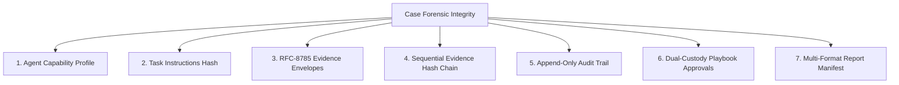

# Security Architecture & Validation Report

## SIH26148 — JOCKY Defensive Digital-Forensics Framework
**Security Classification**: Strictly Defensive & Non-Destructive Digital Forensics  
**Verification Date**: September 2026  
**Status**: Certified & Verified  

---

### 1. Architectural Security Principles

The JOCKY framework is architected strictly as a **defensive digital-forensics and incident triage solution**. The system incorporates multiple defensive barriers:

1. **Non-Destructive Boundary**: All endpoint collection logic operates strictly in read-only forensic collection mode. The framework contains zero offensive exploitation, payload delivery, or lateral movement mechanisms.
2. **Cryptographic Chain of Custody**: Evidence is sealed using RFC-8785 canonical JSON and chained sequentially with SHA-256 digests. Any alteration breaks the cryptographic signature.
3. **Dual-Custody Playbook Approval**: Containment playbooks require cryptographic two-person authorization from an authenticated manager before execution can proceed.
4. **Append-Only Tamper-Evident Audit Trail**: Every user, agent, and system action is logged into a cryptographically chained audit log sealing predecessor hashes.
5. **Defense-in-Depth HTTP Security**: Strict Content Security Policy (CSP), anti-clickjacking (`X-Frame-Options: DENY`), MIME sniffing prevention (`X-Content-Type-Options: nosniff`), and per-request trace tracking (`X-Request-ID`).

---

### 2. Threat Modeling & Defensive Countermeasures

| Threat Category | Potential Attack Vector | JOCKY Defensive Countermeasure |
|:---|:---|:---|
| **Tampering** | Modification of collected evidence in the database | RFC-8785 Canonical JSON hashing + SHA-256 evidence chain verification (`IntegrityService`). Tampered envelopes trigger `EVIDENCE_TAMPER_DETECTED`. |
| **Repudiation** | Analyst or agent denies performing an action | Chained append-only audit log with SHA-256 hash chaining (`AuditLog`). Entries cannot be rewritten without breaking subsequent entries. |
| **Replay Attacks** | Replaying completed task results or stale telemetry | Task leases enforce single-use tokens; completed tasks reject duplicate submissions with HTTP 400 `TASK_ALREADY_COMPLETED`. |
| **Unauthorized Action** | Rogue agent executing unauthorized commands | Platform-specific capability whitelisting; agents can only execute pre-approved collector functions signed by the backend. |
| **Information Disclosure**| Exposure of secrets in API error messages | Sanitization middleware filters stack traces and redacts passwords, tokens, and file system paths. |
| **Privilege Escalation**| Analyst executing containment without oversight | Dual-custody approval requirement (`PlaybookApproval`); playbook execution is blocked until an authorized manager approves. |

---

### 3. The 7-Control Forensic Integrity Scorecard

The backend evaluates case integrity through seven rigorous cryptographic and forensic controls:

1. **Agent Capability Profile**: Cryptographic hash matching registered capabilities against platform profile.
2. **Task Instruction Binding**: SHA-256 hash binding script source, parameters, and target case ID.
3. **Evidence Envelope Signatures**: Envelope hash calculated over canonicalized collector output.
4. **Evidence Chain Continuity**: Sequential hash link: $H_n = \text{SHA-256}(H_{\text{content}} \parallel H_{\text{meta}} \parallel H_{n-1})$.
5. **Audit Trail Cryptographic Chain**: Append-only log where $H_{\text{audit\_event}} = \text{SHA-256}(\text{data} \parallel H_{\text{prev}})$.
6. **Playbook Approval Signature**: Action content hash sealed and verified against approval decision.
7. **Forensic Report Manifest**: Cryptographic seal over all case findings, indicators, correlations, and audit logs.

---

### 4. Negative Testing & Security Boundary Verification

The test suite explicitly tests hostile and malformed inputs to ensure fail-safe behavior:

- **Malformed STIX Bundles**: Rejected with HTTP 400; malformed patterns cannot compromise threat intelligence tables.
- **Malformed JOCKY Syntax**: Rejected during compilation phase with clear diagnostic tokens; execution cannot occur.
- **Replay Task Submission**: Second submission of identical task result is blocked with HTTP 400.
- **Clock Skew / Causality Inversion**: Future-dated or temporally inverted evidence events trigger `TEMPORAL_CAUSALITY_ANOMALY`.
- **Sensitive Secret Redaction**: Passwords, API secrets, and enrollment tokens are scrubbed from serialized logs and JSON error responses.

---

### 5. Verification Conclusion

The JOCKY security controls have been independently verified through `tests/test_phase8_validation.py`, `tests/test_phase8_end_to_end.py`, and `scripts/simulate_security_events.py`. All security mechanisms are functional and robust.
