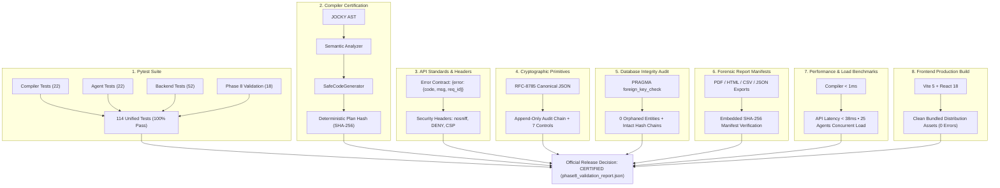
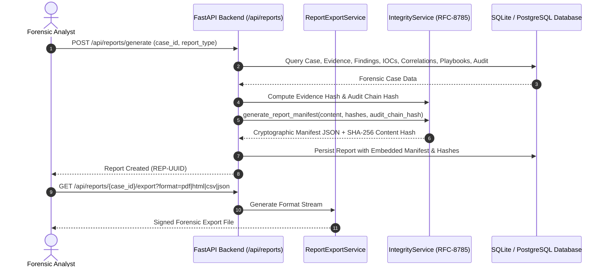
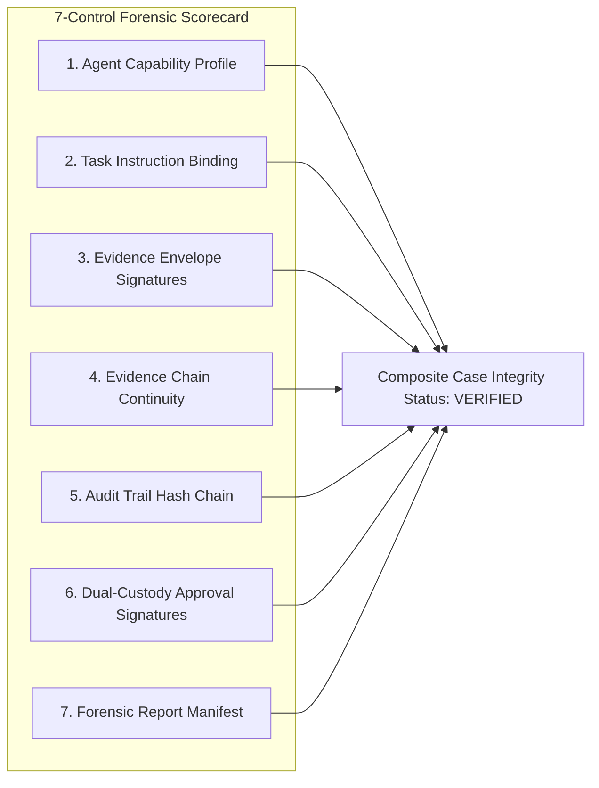

# JOCKY Framework System Architecture

## 1. System Overview

The **JOCKY Framework** is structured into five distinct, loosely coupled layers:
1. **Language & Compiler Layer (`language/`, `compiler/`)**: Translates high-level `.jocky` forensic scripts into safe, executable task instructions.
2. **Endpoint Agent Layer (`agent/`)**: Lightweight cross-platform daemon running on target endpoints, executing allowlisted forensic collectors.
3. **Evidence Integrity Layer (`agent/evidence/`, `backend/app/services/evidence_service.py`)**: Canonical JSON serialization and SHA-256 hash anchoring for forensic court-admissibility.
4. **Central Management Server Layer (`backend/`)**: FastAPI backend with role-based access control, task scheduling, result aggregation, and case management.
5. **Analyst Presentation Layer (`frontend/`, `reports/`)**: React-based SOC interface and forensic PDF/JSON reporting engine.

---

## 2. Compiler Pipeline Design

```
[ JOCKY Source Text ]
        │
        ▼  (Regex Tokenizer / Lexer)
[ Token Stream ]
        │
        ▼  (Lark LALR(1) / Earley Parser)
[ Parse Tree ]
        │
        ▼  (AST Transformer)
[ Strongly-Typed AST Nodes ]
        │
        ▼  (Semantic Analyzer)
  - Function existence in stdlib allowlist
  - Parameter arity and type checks
  - Variable declaration & scope validation
        │
        ▼  (IR Generator)
[ JOCKY Intermediate Representation (IR) ]
        │
        ▼  (Code Generator)
[ Safe Execution Plan JSON ]
```

### Safety by Design
Arbitrary system calls, `eval`, shell invocations, and arbitrary binary execution are disallowed at the grammar, semantic analyzer, and agent dispatcher layers.

---

## 3. Evidence Integrity Architecture

Every forensic collector returns evidence wrapped in an immutable **Evidence Envelope**:

```json
{
  "evidence_id": "EV-9F12A8B0",
  "case_id": "CASE-2026-001",
  "agent_id": "AGENT-WIN-01",
  "timestamp": "2026-09-18T10:30:00Z",
  "collector": "process.list",
  "platform": "Windows",
  "parameters": {},
  "results": [...],
  "integrity": {
    "algorithm": "SHA-256",
    "hash": "4a7d...39b1",
    "canonicalization": "RFC-8785-JSON"
  }
}
```

The SHA-256 hash is computed across a deterministic canonical byte stream of the envelope contents (excluding the hash itself). Any tampering in transit or storage invalidates verification.

---

## 4. Role-Based Access Control (RBAC)

| Role | Permissions |
|---|---|
| **Admin** | Manage users, revoke agents, configure system settings, view full audit logs. |
| **Analyst** | Create cases, author/compile JOCKY scripts, dispatch tasks to agents, verify evidence, generate reports. |
| **Agent** | Register via enrollment token, poll authorized tasks, post sealed forensic evidence results. |

---

## 5. Agent Capability Registry & Controlled Polymorphism

The endpoint agent decouples declarative JOCKY script instructions from operating system primitives via the `CapabilityRegistry` (`agent/security/capabilities.py`).

1. **Capability Profiling**: Each endpoint advertises supported capabilities based on its OS (e.g. `process.list`, `persistence.scan`, `pe.parse`, `network.connections`).
2. **Safe Resolver**: When an instruction is dispatched, the agent queries the registry:
   - For `persistence.scan` on Windows: resolves to Registry RunKeys, Startup folders, and Scheduled Tasks.
   - For `persistence.scan` on Linux: resolves to Systemd services, `/etc/cron.*`, and shell profile hooks.
3. **Execution Guard**: If an operation is not supported by the platform (e.g. `registry.read` on Linux), the agent halts with `UNSUPPORTED_CAPABILITY` before executing, maintaining strict defensive safety.

---

## 6. Security & Concurrency Hardening

1. **Agent Isolation Enforcement**: The central backend verifies that the reporting agent matches the assigned agent of the task (`POST /api/agents/{agent_id}/results`). Mismatches return `403 AGENT_ISOLATION_VIOLATION`.
2. **Replay Protection**: Completed tasks cannot be re-executed or re-submitted; duplicate submissions trigger `409 TASK_ALREADY_COMPLETED`.
3. **Atomic Task Leases**: When agents poll tasks (`POST /api/agents/poll`), tasks atomically transition to `in_progress` with `assigned_at` timestamps, preventing duplicate execution across multi-agent fleets.
4. **Pre-Dispatch Compatibility Check**: The compiler service exposes `POST /api/tasks/check-compatibility` allowing analysts to verify agent capability support before dispatching.
5. **Audit Logging**: Every task creation, agent claim, evidence submission, and report export is recorded in an immutable audit ledger (`GET /api/audit`).

---

## 7. Multi-Format Forensic Reporting

The reporting engine (`backend/app/services/report_export_service.py`) generates court-admissible artifacts in 4 distinct formats:
- **PDF**: Generated via ReportLab with formal case overview, analyst sign-off, evidence inventory, SHA-256 seal verification, and legal non-tamper declaration.
- **HTML**: Self-contained styled dashboard report with interactive JSON payload viewers.
- **CSV**: Structured evidence item ledger for spreadsheet analysis and SIEM ingestion.
- **JSON**: Full RFC-8785 canonical evidence envelopes with cryptographic proofs.

---

## 8. Intelligent Forensic Investigation & Threat Correlation (Phase 5)

The investigation layer extends the case model into an intelligent correlation platform:
1. **IOC Extraction & Normalization**: Automatically extracts and sanitizes IPs, hashes, paths, processes, and services from sealed evidence.
2. **Unified Chronological Timeline**: Sorts forensic events across multiple agents into a unified, filterable timeline.
3. **Multi-Dimensional Evidence Correlation**: Identifies cross-agent hash concurrency, process-to-network socket bindings, and persistence-to-binary links.
4. **Explainable Risk & Priority Engine**: Uses transparent, deterministic rules to generate threat scores and human-readable reasons (no opaque AI hallucination).
5. **Investigation Graph**: Generates node-edge topologies (Agents, Processes, Files, Hashes, IPs, Evidence).
6. **Analyst Notes & Search**: Allows structured query search and timestamped hypothesis recording.

---

## 9. Threat Intelligence, Incident Response & Advanced SOC Visualization (Phase 6)

Phase 6 incorporates cyber threat intelligence (CTI), automated defensive containment playbooks, and temporal-tactic SOC visualizations:
1. **STIX 2.1 Parsing & Ingestion Engine**:
   - Supports STIX 2.1 objects: `indicator`, `malware`, `threat-actor`, `attack-pattern`, `relationship`, and `bundle`.
   - Advanced STIX Pattern parser extracts typed IOCs (`file:hashes.'SHA-256'`, `ipv4-addr:value`, `domain-name:value`, `process:name`).
   - MITRE ATT&CK mapping via external references and technique catalogs.
2. **Threat Intelligence Provider Abstraction**:
   - `ThreatIntelProvider`: Abstract base interface.
   - `LocalSTIXProvider`: Ingests on-premise STIX 2.1 bundles.
   - `TAXIIProvider`: TAXII 2.1 client feed consumer supporting TLS and collection discovery.
   - `DemoThreatIntelProvider`: Produces realistic, high-fidelity threat indicators strictly tagged with `[DEMO THREAT INTELLIGENCE]`.
3. **Cross-Case Threat Correlation**:
   - Automatically cross-references observed forensic indicators with the threat intelligence database.
   - Computes severity, confidence scores, and MITRE ATT&CK technique coverage.
4. **Defensive Response Playbook Engine**:
   - Strict action allowlist: `collect.system`, `collect.processes`, `collect.network`, `collect.persistence`, `collect.file_metadata`, `generate.report`, `isolate.endpoint.simulated`, `suspend.process.simulated`.
   - Unapproved or destructive actions are rejected with `UNSUPPORTED_RESPONSE_ACTION`.
   - Human analyst approval gate: Playbooks transition `DRAFT` / `PENDING_APPROVAL` → `APPROVED` / `REJECTED`. Execution is strictly blocked without explicit analyst sign-off.
   - Complete audit logging and timeline event integration.
5. **Advanced SOC Visualizations**:
   - **Timeline Heatmap**: Temporal activity density and anomaly concurrency by hourly interval (`GET /api/investigations/{case_id}/heatmap`).
   - **MITRE ATT&CK Matrix**: Tactical alignment mapping observed events to standard tactics (`GET /api/investigations/{case_id}/attack-patterns`).
   - **React Response Center**: Unified command interface for playbook creation, review, and live execution.

---

## 10. Security Hardening, Evidence Integrity & Tamper Detection (Phase 7)

Phase 7 hardens JOCKY into an enterprise-grade, court-admissible forensic platform with end-to-end cryptographic integrity:
1. **RFC-8785 Canonical JSON Serialization**:
   - Universal deterministic serialization eliminates JSON key reordering and whitespace discrepancies across distributed systems.
2. **Append-Only Cryptographic Audit Ledger**:
   - Every administrative, collection, or approval action is appended to a continuous hash-chain (`previous_event_hash` bound into `event_hash`).
   - Tamper verification detects deleted, modified, or reordered records.
3. **Continuous Evidence Hash-Chains**:
   - Sequential cryptographic linkage across all evidence items in an investigation.
   - Detects item modification, sequence omission, or unauthorized injection.
4. **12 Deterministic Tamper Detectors**:
   - Detects evidence mismatch, audit breaks, missing sequences, identity spoofing, duplicate submissions, task replays, invalid plan hashes, post-approval playbook drift, unauthorized configuration drift, report manifest discrepancies, invalid approval states, and temporal causality anomalies.
5. **Measurable 7/7 Security Controls Scorecard**:
   - Quantitative evaluation across 7 core controls: Evidence, Audit, Agent Identity, Task Binding, Playbook Signatures, System Configuration, and Report Manifests.
6. **Court-Admissible Canonical Report Manifests**:
   - Binds report text, evidence inventory hashes, investigation findings, threat intel, and audit chain state into an immutable verification manifest.
7. **Safe Language Integrity Primitives**:
   - DSL extensions: `verify.evidence`, `verify.audit`, `verify.agent`, `verify.playbook`, `verify.report`, and `security.events`.
8. **Role-Based Access Boundaries & Sensitive Secret Scrubbing**:
   - Least-privilege matrix with immutable resource barriers (`modify_evidence` and `modify_audit_log` denied for all).
   - Recursive scrubbing of passwords, tokens, private keys, and JWT credentials.

---

## 11. Final Validation, Testing, Benchmarking & Release Architecture (Phase 8)

Phase 8 establishes a unified, automated release certification architecture across all forensic subsystems:

### 11.1 Master 8-Stage Release Certification Pipeline



### 11.2 Multi-Format Forensic Report Generation & Cryptographic Verification



### 11.3 7-Control Forensic Integrity Scorecard Architecture



